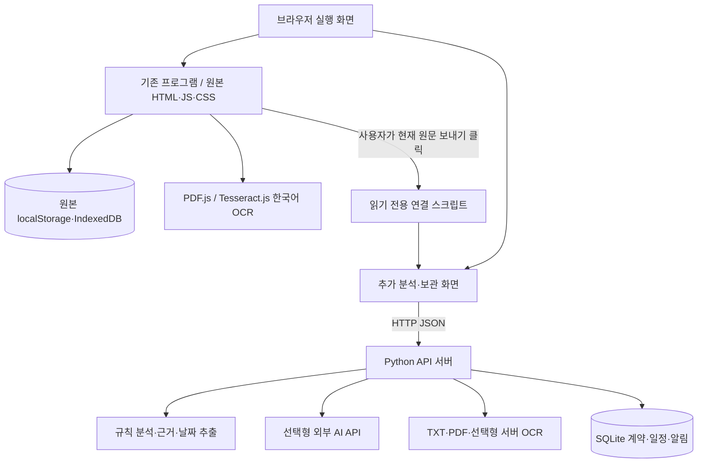

> 화면 분리 수정판: `index.html`에 현재 화면만 표시하는 CSS fallback을 추가했습니다. 기존 JavaScript·분석·저장·일정 기능은 바꾸지 않았습니다. 아래 원본 5개 보존 기록은 이전 확장판 제작 시점의 기록이며, 이 수정판은 원본 4개를 그대로 보존하고 HTML 한 곳만 수정했습니다. 상세 내용은 SCREEN_FIX.md를 참고하세요.

# 내손을 java · 기존 코드 보존 확장판

사용자가 제공한 `일로와.zip`의 프로그램을 기본으로 두고, Python·SQLite 기반 추가 분석 서비스를 별도 폴더로 연결한 버전입니다. 기존 `index.html`, `css/style.css`, `js/app.js`, `js/analyzer.js`, `js/rules.js`는 변경·삭제하지 않았습니다. 파일 해시 목록은 `ORIGINAL_FILES.json`입니다.

## 웹앱인가요, 설치형 앱인가요?

**브라우저에서 쓰는 웹앱입니다.** 화면은 HTML/CSS/JavaScript로 실행되고 추가 기능은 같은 PC에서 실행한 Python 서버와 통신합니다. EXE 설치형 앱이나 Android/iOS 앱을 만든 것은 아닙니다.

- 원본만 사용: `index.html`을 열어 기존 기능을 사용할 수 있습니다. 다만 PDF·OCR·외부 CDN·브라우저 보안 제약 때문에 로컬 서버를 통한 실행을 권장합니다.
- 원본+추가 기능: 아래 `python run.py`로 실행하고 `http://127.0.0.1:8766`을 엽니다. HTML 더블클릭만으로 Python API·SQLite 기능이 실행되지는 않습니다.
- GitHub는 코드 제출·버전 관리 장소입니다. GitHub Pages는 Python 서버나 SQLite 백엔드를 실행하지 못합니다.

## 언어와 선택 이유

|역할|기술|이유|
|---|---|---|
|화면 구성|HTML|사용자 원본 화면을 그대로 사용|
|디자인|CSS, 원본 Tailwind CDN|기존 네이비·골드·아이보리 유지|
|사용자 동작|JavaScript|원본 촬영·파일·OCR·달력·알림이 이미 브라우저 JS로 작성됨|
|추가 서버|Python 3.12 권장|문서 처리·정규식·AI 호출 코드를 학생들이 읽고 설명하기 쉬움|
|추가 영구 저장|SQLite, SQL|별도 DB 설치 없이 한 파일로 계약·일정 관계를 저장|

작품명의 `java` 때문에 Java 언어를 강제로 선택하지 않았습니다. 원본의 언어는 HTML/CSS/JavaScript이고, 추가 서버 언어는 Python입니다.

## 백엔드 구조도



기존 프로그램은 브라우저 자체에서 처리하는 구조로 Python 백엔드가 없었습니다. 추가 기능은 `run.py`가 원본 정적 파일을 제공하고, `extensions/server-assistant/server.py`의 API를 재사용합니다. 추출·분석·AI·저장을 각각 `backend/extraction.py`, `analysis.py`, `ai.py`, `storage.py`로 분리했습니다.

원본 데이터는 `localStorage/IndexedDB`, 추가 데이터는 `extensions/server-assistant/data/app.sqlite3`에 보관됩니다. **두 저장소를 자동 동기화하거나 서로 삭제하지 않습니다.** 원문을 보내도 새 화면의 입력칸에만 채워지며 사용자가 다시 확인해야 분석·저장됩니다. 기존 화면에서 항목 값만 교정한 내용은 원문 변경이 아니므로 추가 화면에 자동 반영되지 않습니다. 추가 화면에서 원문을 직접 수정하세요.

## 카메라 기능

원본에 `<input type="file" accept="image/*" capture="environment">`가 이미 있습니다. 지원하는 모바일 브라우저에서 촬영 버튼이 후면 카메라를 요청하는 방식입니다. PC에서는 파일 선택창이 열릴 수 있습니다. 웹캠 실시간 영상 처리(`getUserMedia`) 방식은 아닙니다.

원본에는 Tesseract.js 한국어 OCR과 스캔 PDF 페이지 OCR도 구현되어 있습니다. 이 코드는 그대로 보존했습니다. 원본 OCR은 CDN·WASM·한국어 언어 데이터 다운로드가 필요합니다. 추가 서버의 네이티브 OCR은 별개이며 Tesseract 실행 파일+kor/eng 데이터 설치가 필요합니다. 현재 실제 휴대폰 촬영·한국어 OCR 인식률·OS 알림 배너는 검증하지 않았습니다.

서버는 현재 PC의 127.0.0.1에만 열려 있습니다. 휴대폰에서 PC의 localhost로 접속할 수 있는 구성은 아닙니다. 휴대폰 기기 시연용 HTTPS 배포/네트워크 설정은 별도 작업입니다.

## 원본에서 보존한 기능

- 모바일 촬영 입력, 사진 미리보기
- PDF.js 실제 텍스트 추출과 첫 장 미리보기
- Tesseract.js 한국어 이미지·스캔 PDF OCR 코드
- 표준근로계약서 양식 분류, 필드 추출, 항목 교정·재검사
- 브라우저 계약 저장과 IndexedDB 원본 파일 보관 코드
- 기존 계약 상세, 일정 추가·삭제·달력·D-day·알림 설정
- 기존 규칙 판정·샘플·뉴스·상담 로직

원본에 있는 ‘안전/위반’ 판정, 상대 날짜 샘플, 실행 시점 고정 TODAY, 특정 날짜 정규화 등도 수정하지 않았습니다. 따라서 원본 표시를 법률적 안전성·위법 확정으로 해석하면 안 됩니다. 원본 전부의 품질을 보증하거나 모든 기능을 새로 검증했다고 주장하지 않습니다.

## 추가한 기능

- 별도 Python API·SQLite 영구 저장
- 직접 원문·TXT·텍스트 PDF 입력, 원문 수정·확인
- 계약별 실제 원문 발췌 요약·기간·금액·지급 조건·주의 후보·쉬운 설명·인용 위치
- 미정 조건의 확인 불가 표시, 규칙 분석과 실제 AI 설명 구분
- API 키를 서버 환경변수에 둔 선택형 AI 연결·오류 처리
- 원문에 명시된 날짜를 일정 후보로 제시하고 사용자 확인·수정 후 등록
- 계약 ID별 보관·상세·검색·유형/자료 필터·삭제와 연결 일정 정리
- 추가 저장소의 일정 수정·알림 중복 방지·자정 갱신
- 선택한 계약 문장 검색 또는 선택형 AI 설명
- 원본 추출 원문을 읽기 전용으로 추가 화면에 복사하는 버튼
- 테스트·합성 평가·시연 대본·보고서/포스터 초안

## 실행 방법 (Windows)

Python 3.12를 설치하고 ZIP을 푼 뒤 **이 README와 run.py가 있는 폴더**에서 터미널을 엽니다.

```powershell
python -m venv .venv
.\.venv\Scripts\python.exe -m pip install -r requirements.txt
.\.venv\Scripts\python.exe run.py
```

[확장판 실행 화면](http://127.0.0.1:8766)을 엽니다. 터미널은 시연하는 동안 열어 두고, 종료는 Ctrl+C입니다. 이미 실행 중이면 같은 서버를 다시 띄우지 말고 브라우저를 여세요. 포트 충돌 시 실행 전 `$env:PORT="8770"`처럼 지정하세요.

첫 번째 탭이 원본이고 두 번째 탭이 추가 기능입니다. 원본에서 PDF를 읽거나 사진 OCR을 끝낸 다음 상단 **현재 원문 보내기 →**를 누르면 추가 입력 화면으로 복사됩니다. 추가 화면의 이름·유형·원문 확인란을 확인한 뒤 분석·저장하세요. 원문이 아직 없으면 기존 화면 데이터는 그대로 두고 안내만 표시합니다.

API 키 없이 로컬 규칙 모드로 실행할 수 있습니다. 실제 AI를 쓰려면 `extensions/server-assistant/.env.example`을 같은 폴더의 `.env`로 복사해 키·모델을 설정하고 서버를 재시작하세요. 확장판 주소를 유지하려면 그 파일의 `PORT`를 `8766`으로 설정하세요. 키·DB·실제 계약서는 GitHub에 올리지 마세요.

## GitHub Desktop으로 올리기

1. ZIP을 풉니다. 업로드할 폴더에는 `index.html`, `run.py`, `extensions`, `.gitignore`가 함께 있어야 합니다.
2. GitHub Desktop에서 **File → New repository**로 빈 저장소를 만듭니다. 이름은 팀에서 정합니다. 이 폴더가 이미 Git 저장소라면 **File → Add Local Repository**를 사용하세요.
3. 새로 만든 저장소 폴더 안에 이 확장판의 **내용 전체**를 복사합니다. ZIP 파일 하나만 넣지 마세요. 점으로 시작하는 `.gitignore`도 포함합니다.
4. Changes에서 원본 5개와 추가 소스를 확인합니다. `.env`, `data`, `work`, DB 파일, 실제 계약서가 보이면 커밋하지 말고 제외 설정을 확인하세요.
5. Summary에 `기존 코드 보존 및 서버 기능 추가`를 적고 **Commit to main**을 누릅니다.
6. **Publish repository**를 누릅니다. 제출 규정상 공개해야 하면 **Keep this code private**를 해제하고 게시합니다.
7. GitHub 저장소의 README와 파일 목록이 보이는지 확인하고 저장소 주소를 제출합니다.
8. 이후 수정은 Changes 확인 → Commit → Push origin 순서입니다.

공식 안내: [새 저장소 만들기](https://docs.github.com/en/desktop/overview/creating-your-first-repository-using-github-desktop), [기존 프로젝트 게시](https://docs.github.com/en/desktop/adding-and-cloning-repositories/adding-an-existing-project-to-github-using-github-desktop?platform=windows). [GitHub Pages는 Python 서버를 지원하지 않습니다](https://docs.github.com/en/pages/getting-started-with-github-pages/creating-a-github-pages-site). 교수님은 소스를 내려받아 README대로 로컬 실행하면 됩니다. 온라인 백엔드 배포는 이번에 수행하지 않았습니다.

## 보존 확인·테스트

```powershell
.\.venv\Scripts\python.exe verify_originals.py
# 원본 5개 SHA-256 일치, 변경·삭제 0개
cd extensions/server-assistant
..\..\.venv\Scripts\python.exe -m pip install -r requirements-dev.txt
..\..\.venv\Scripts\python.exe -m unittest discover -s tests -v
..\..\.venv\Scripts\python.exe -m evaluation.run
```

상세 검증 기록은 `ADDITIVE_VALIDATION.md`, 기존 추가 모듈 21개 테스트·합성 평가·한계는 `extensions/server-assistant/docs/VALIDATION.md`에 있습니다. 처음 제작했던 별도 버전은 원본 UI를 참고해 기능을 재구현한 것이며, 사용자 첨부 자체를 덮어쓴 적은 없습니다. 이번 보존 확장판은 새 ZIP의 5개 소스 자체를 그대로 포함합니다.
