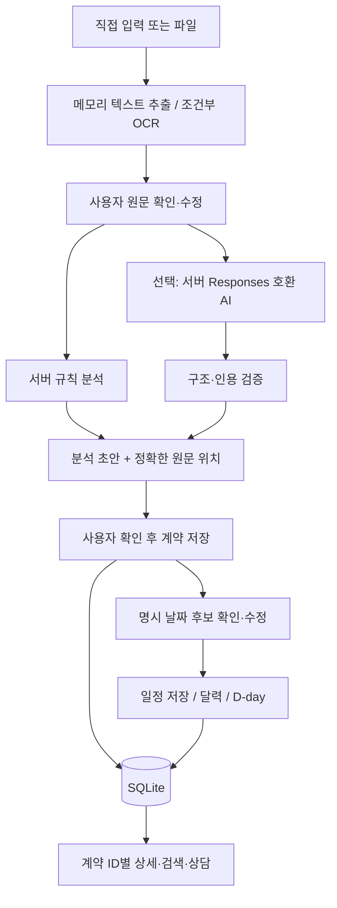

# 기능 명세와 시스템 구조

## 데이터 흐름

프런트엔드는 `app.js`에서 화면 상태만 관리하고 영구 데이터는 HTTP API를 통해 저장한다. 새로고침 시 `GET /api/state`로 복원한다. 서버를 재시작해도 같은 DB 경로라면 데이터가 유지된다. 브라우저 시간대의 오늘 날짜를 사용하며 날짜 차이는 UTC 날짜 숫자로 계산해 일광절약시간 오차를 줄인다.

## SQLite

|테이블|내용|관계|
|---|---|---|
|drafts|ID·이름·유형·원문·분석 JSON·샘플 구분|분석 초안; 24시간 지난 초안은 다음 분석 시 정리|
|contracts|ID·이름·유형·원문·분석 JSON·샘플 구분·생성시각|사용자가 저장한 계약|
|events|ID·계약 ID(nullable)·일정명·ISO 날짜·알림·원문 근거|계약 삭제 시 CASCADE|
|settings|표시 이름·전체 알림·사전일·시간 JSON|단일 사용자 설정|
|notifications|일정 ID·알림 표시일|복합 PK, 일정 삭제 시 CASCADE|

원본 파일은 보관하지 않고 추출한 편집 원문을 저장한다. OCR 이미지는 `work/` 임시 폴더에서 처리 후 제거한다. 가상 샘플로 시작한 문서는 수정하더라도 가상 자료로 분류한다. 사용자 직접 입력·일반 업로드는 사용자 자료로 분류하며 그 내용이 실제 계약인지 자동 판별하지 않는다.

## API

|메서드·경로|역할|
|---|---|
|GET /api/state|계약·일정·설정 조회|
|GET /api/capabilities|키 존재 여부(값 제외), OCR 상태|
|GET /api/sample|가상 개발 예시 원문|
|POST /api/extract|파일 이름·base64 데이터 → 편집용 원문|
|POST /api/analyze|이름·유형·원문·모드 → 분석 및 초안 ID|
|POST /api/contracts|초안 ID → 계약 저장, 반복 저장은 같은 ID|
|PATCH /api/contracts/:id|계약 이름·유형 변경|
|DELETE /api/contracts/:id|계약·초안·연결 일정·알림 삭제|
|POST /api/events|계약 ID·제목·날짜·알림·근거 → 일정|
|PATCH /api/events/:id|일정 수정·알림 변경|
|DELETE /api/events/:id|일정·알림 기록 삭제|
|PUT /api/settings|프로필·알림 설정 저장|
|POST /api/notifications/claim|DB 고유키로 당일 중복 알림 방지|
|POST /api/consult|보관 계약 ID·질문·모드 → 검색/AI 설명|

인증 대신 127.0.0.1 바인딩, Host/Origin 검증, JSON+사용자 지정 헤더로 다른 웹사이트가 로컬 API를 쓰는 것을 제한한다. 외부 서비스로 배포하려면 인증·TLS·사용자별 권한·파일 격리·요청 제한 등을 별도로 구현해야 한다. 현재 HTTP 서버는 표준 라이브러리이며 운영 서비스용이 아니다.

## 분석 범위와 화면 상태

원문 줄 단위 발췌 요약과 조건 추출이 기본이다. 원문에 없는 기간·금액·지급 조건은 `확인 불가`. 5종 확인 항목은 키워드 후보이며 위법·안전 판정이 아니다. 쉬운 설명은 사전 정의와 해당 원문을 함께 표시한다. 날짜는 실제 유효한 완전 연월일만 후보로 제시하고 만료·통보 날짜를 임의 추정하지 않는다. 근거 위치는 편집된 원문의 Python 유니코드 코드포인트, 0부터 시작, 끝 제외. PDF 쪽 표시는 추출 원문에 삽입한 머리말 기준이며 원본 페이지 좌표는 아니다.

업로드·추출 중/분석 중에는 상태와 비활성 버튼, 성공 시 원문 또는 결과, 실패 시 오류 문구, 빈 목록에는 별도 안내를 표시한다. 분석 중 화면 이동은 차단해 진행 중 원문과 결과가 섞이는 것을 줄인다. 원문 확인 체크는 파일 추출·본문 수정 때 해제한다.

## AI 안전 경계

문서·질문을 JSON 데이터로 넣고 서버 instructions와 분리한다. 원문 내부 명령을 따르지 말라는 지시, 도구 미부여, 응답 JSON/종류/길이/인용 검증을 조합한다. 이 설계가 모든 프롬프트 인젝션 또는 의미 오류를 해결한다고 주장하지 않는다. AI 설명은 검토가 필요한 참고 내용이다. 법률 출처·법제도 설명은 이 버전에서 제공하지 않는다.
